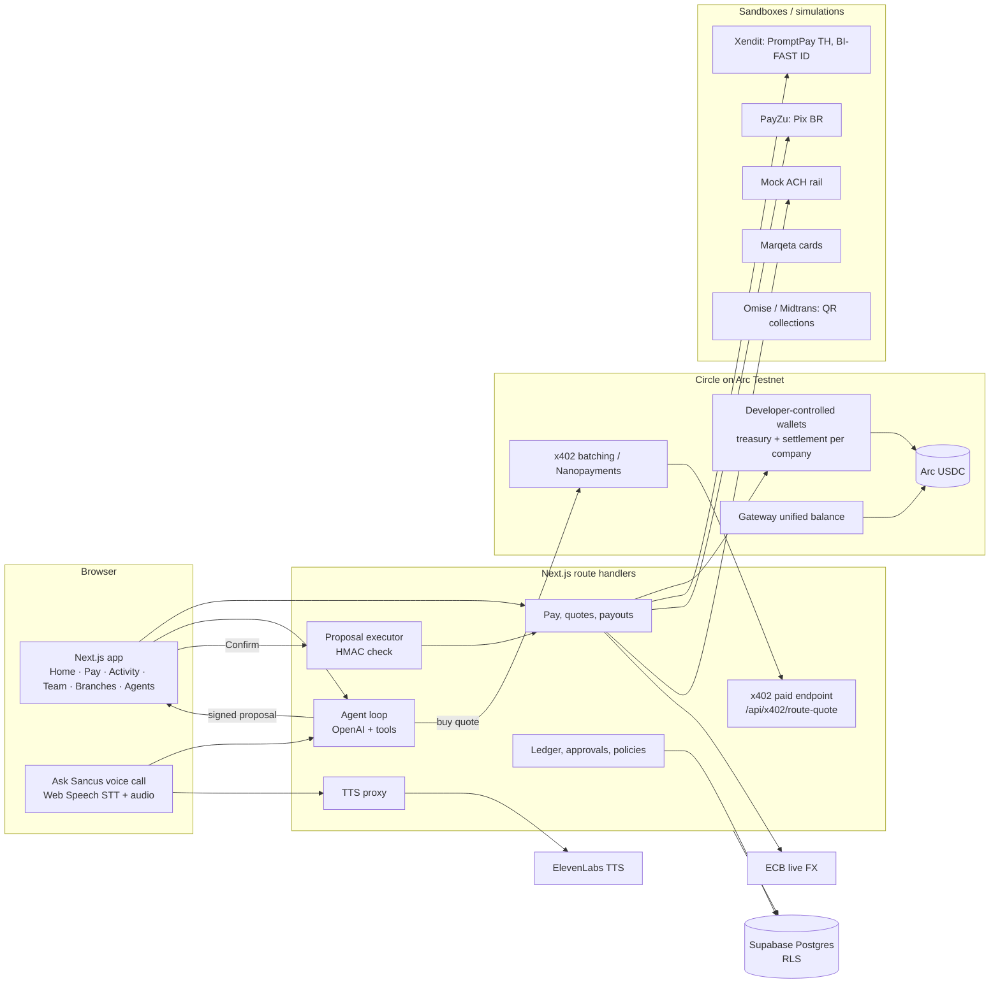

# Sancus

**One USDC balance to pay suppliers, staff and families across borders, with an AI agent that does the paperwork and never moves money without you.**

> Sancus was the Roman god of trust, oaths and contracts. Sancus, the product, is a stablecoin account where the rules are enforced by code.

Sancus is a stablecoin business account built on **Arc** and the **Circle** developer suite. A company (or a person) holds one USD balance in USDC, then pays people in **Thailand (PromptPay), Indonesia (BI-FAST) and Brazil (Pix)**, or US bank accounts by ACH, from that one balance. The user picks *who* and *how much*; Sancus quotes the live rate, picks the rail and settles. The blockchain stays invisible.

On top sits the **Sancus agent**: tell it, by text or by voice, what you want ("pay Siam Packaging 5,000 baht for invoice INV-88"). It looks things up, buys live route data with **x402 nanopayments** from its own budgeted wallet, and prepares every payment as a **signed card you confirm**. It can also open the right page and answer questions about the page you're on.

> ⚠️ **Hackathon prototype on testnets.** Circle wallets, Gateway and x402 run on Arc Testnet; payout and card partners run in their sandboxes or as clearly labeled simulations. No real customer funds. See [What's real and what's simulated](#whats-real-and-whats-simulated).

**Live app:** https://sancus-peach.vercel.app · **Demo logins:** in our Devpost submission

---

## Hackathon submission (UBC 2026)

| | |
|---|---|
| **Main track** | Agentic Payments and AI |
| **Chain award** | Best use of Arc |
| **Bounty** | Best Project built with ElevenLabs |
| **Required for the track** | [Agent decision loop and safety limits](#the-agent-decision-loop-and-safety-limits) |
| **Required for Arc** | [How Sancus uses Arc](#how-sancus-uses-arc) and [contract addresses](#contract-addresses-arc-testnet-chain-id-5042002) |
| **Required for ElevenLabs** | [Voice: how we use ElevenLabs](#voice-how-we-use-elevenlabs) |

### What did we build?
A multi-entity stablecoin account (global HQ, country branches, employees, and personal accounts) with local payouts, collections, cards, approvals, and an AI agent that can safely spend on the user's behalf.

### What problem does it solve?
A company with suppliers and staff in emerging markets juggles a bank account per country, slow and expensive wires, and opaque FX. Families sending money home have the same problem at a smaller scale. Sancus gives them one dollar balance, live FX quotes, and local rails that arrive in seconds, plus spending controls so a business can let employees and an AI agent act without handing over the keys.

### What makes it unique?
- **Both sides of agent payments:** the Sancus agent *pays* for data over x402 from a capped wallet, and Sancus *sells* its route quotes to other agents over x402 (revenue lands in the treasury).
- **The agent can't move money on its own:** every action is an HMAC-signed, expiring proposal bound to the user and the exact request; only the user's Confirm (tap or voice) runs it.
- **Voice that acts:** an "Ask Sancus" call on every page answers questions about the screen, navigates, and prepares payments you confirm by voice.
- **Accounts that match real companies:** HQ → branches → people, each with its own wallet, balance, limits and permissions.

---

## Architecture



The app started from Circle's [arc-fintech](https://github.com/circlefin/arc-fintech) sample (Apache-2.0) for auth, wallets and Gateway plumbing; everything under "Sancus" (accounts, payouts, agent, voice, x402, ledger, branches, cards, QR) was built during the hackathon. See [app/UPSTREAM.md](app/UPSTREAM.md).

---

## Tech stack

### Chain: Arc Testnet (chain ID 5042002)
USDC is the gas token, so every fee is in dollars and nobody needs a second token. All Sancus onchain activity (treasuries, payouts, card settlement, QR payments, x402) happens on Arc Testnet.

### Circle products we call

| Circle product | Package | What Sancus does with it | Where |
|---|---|---|---|
| **Developer-Controlled Wallets** | `@circle-fin/developer-controlled-wallets` | One wallet set per company; an **SCA** treasury and a settlement wallet on Arc for every company node (HQ and each branch), plus personal treasury / settlement wallets and Gateway signer wallets. | `lib/sancus/provision-circle.ts`, `lib/sancus/company-wallets.ts` |
| **App Kit** (with the Circle Wallets adapter) | `@circle-fin/app-kit`, `@circle-fin/adapter-circle-wallets` | `kit.send` moves USDC between Circle wallets on Arc (payout settlement legs, ACH funding, QR payments when fUSDC is off); `kit.unifiedBalance.*` reads, deposits to and spends the Gateway balance; `kit.swap` swaps USDC ⇄ EURC on Arc. | `lib/circle/app-kit-send.ts`, `lib/circle/gateway-sdk.ts`, `app/api/swap/` |
| **Gateway** (unified USDC balance) | via App Kit `unifiedBalance` | Treasury deposits and the x402 revenue sit in the Gateway balance; the treasury total = wallet USDC + Gateway USDC. Gateway webhooks keep balances fresh. | `lib/circle/gateway-sdk.ts`, `lib/sancus/treasury.ts`, `app/api/circle/gateway-webhook/` |
| **Gateway Nanopayments / x402** | `@circle-fin/x402-batching` (`GatewayClient`, `BatchFacilitatorClient`) | Both sides of x402 on Arc: the agent *pays* per request from its own Gateway-funded wallet, and Sancus *sells* `/api/x402/route-quote` to other agents, verifying and settling each payment with Circle's batching facilitator. Gasless, batched. | `lib/sancus/agent/x402-wallet.ts`, `lib/sancus/x402.ts`, `app/api/x402/` |
| **Webhooks** | Circle notifications | Wallet and Gateway events update transfers and balances. | `app/api/circle/webhook/`, `app/api/circle/gateway-webhook/` |

Also in the codebase from the arc-fintech starter but not part of the Sancus demo: CCTP bridging and rebalancing (`app/api/bridge/`), EarnKit vaults (`app/api/earn/`), the Onramp Kit (`app/api/onramp/`) and the Compliance Engine. We don't use Circle Gas Station / Paymaster directly; transactions go through the developer-controlled wallets with a set fee level.

### x402 in detail
| | |
|---|---|
| **Sold endpoint** | `GET /api/x402/route-quote?country=ID\|TH&amount=…&recipientType=MOBILE\|BANK`: cheapest payout route (rail, live FX rate, fee, USDC cost, arrival) |
| **Price** | $0.01 USDC per call (`SANCUS_X402_PRICE`) |
| **Network** | Arc Testnet, `eip155:5042002`, asset Arc USDC `0x3600…0000`, Gateway Wallet `0x0077…19B9` |
| **Flow** | Request → `402 Payment Required` with a `PAYMENT-REQUIRED` header (terms) → client retries with a signed `PAYMENT-SIGNATURE` (Gateway payment) → Sancus verifies + settles with `BatchFacilitatorClient` → records the earning, posts ledger revenue, returns the data with `PAYMENT-RESPONSE` |
| **Where revenue lands** | The Gateway balance of the receiving account's Arc treasury wallet (`SANCUS_X402_PAY_TO`); shown as x402 earnings on the Agents page |
| **Buyer side (our agent)** | `GatewayClient` on `arcTestnet` with its own key (`BUYER_PRIVATE_KEY`), topped up into Gateway (`AGENT_X402_DEPOSIT_USDC`); every purchase is checked against the **$0.50 daily cap** (`AGENT_X402_DAILY_CAP_USDC`) and logged; payment validity window 7 days |

### Smart contracts on Arc
Sancus deploys one ERC-20 contract, [`SancusMockStablecoin.sol`](app/contracts/mock-stablecoin/SancusMockStablecoin.sol), several times: **fUSDC** (Face USDC, our mintable test settlement token) and local-currency tokens **mTHB, mIDR, mBRL** minted when a local QR collection is paid. A rail bot holds the minter role; an fUSDC "transfer" is a burn from the payer then a mint to the receiver, and the Process page shows both transactions. A mock equity broker and tokens back the tokenized-stock treasury stretch. Addresses: [Contract addresses](#contract-addresses-arc-testnet-chain-id-5042002).

Spending rules (budgets, per-payment and daily limits, approvals) are enforced in the app and the database, not in a contract yet.

### AI and voice
| | |
|---|---|
| **Agent model** | OpenAI **GPT-4o** by default (`OPENAI_AGENT_MODEL`), Chat Completions with function calling, run by our own tool loop (`lib/sancus/agent/openai-runner.ts`), max 12 steps, streamed to the browser as NDJSON |
| **Agent tools** | balances, payees, live quotes, `propose_payment` / `propose_collection` / `propose_limits` (signed proposals), `buy_route_quote` (x402), `recent_activity`, `my_spending`, `open_page`, `request_payment_qr` |
| **Proposals** | HMAC-SHA256 signed, bound to the user and the exact request, expire in 10 minutes, allowlisted endpoint per kind, idempotent execution |
| **Voice out** | **ElevenLabs** streaming text-to-speech, **Flash v2.5** (`eleven_flash_v2_5`), text normalization on, voice "Sarah"; sentences stream in parallel, progress phrases pre-recorded |
| **Voice in** | Browser Web Speech API (Chrome / Edge) |

### Payment rails and partners
| Rail | Direction | Partner | Status |
|---|---|---|---|
| PromptPay (Thailand) | Pay out | Xendit | Test mode, labeled simulation when money-out is off |
| BI-FAST (Indonesia) | Pay out | Xendit | Test mode, labeled simulation when money-out is off |
| Pix (Brazil) | Pay out | PayZu | Sandbox when a key is set, otherwise labeled simulation |
| ACH (US) | Pay out | Mock ACH rail | Simulated bank leg, real onchain funding |
| PromptPay QR | Collect | Omise | Sandbox |
| QRIS (Indonesia) | Collect | Midtrans | Sandbox |
| Virtual cards | Spend | Marqeta | Sandbox (simulated when unconfigured); settles onchain on Arc |
| NFC tap to pay | Spend | Web NFC + Android HCE companion (`nfc-android/`) | Proof of concept on real Android radios, card settlement through Sancus |
| Sancus QR | Person to person | Sancus (signed QR) | Real onchain payment on Arc between Sancus accounts |
| USDC | Send / receive | Arc | Real (testnet) |

FX: live ECB reference rates from Frankfurter, with open.er-api as a fallback, cached 10 minutes. QR: EMVCo parser for PromptPay / Pix / QRIS, `jsQR` and the browser's `BarcodeDetector` for scanning, `qrcode` for generating.

### App and data
Next.js 16 (App Router, Turbopack) · React 19 · TypeScript · Supabase Postgres with row-level security and SQL migrations · Supabase Auth · viem · Zod · Vitest · Vercel.

---

## Features

| Area | What it does |
|---|---|
| **Account types** | Business admin (whole company), Branch admin (one branch), Employee (card + limits), Personal (no business). Each sees only what its permissions allow. |
| **Company tree** | Global HQ (US) with branches in Indonesia, Thailand, Brazil and the US. Each node has its own Circle treasury and settlement wallet; the org chart shows who works where. |
| **Pay** | Pick a payee, enter what they get or what you send; the quote converts from USDC at the live ECB rate. PromptPay (TH), BI-FAST (ID), Pix (BR), ACH (US). |
| **Scan a QR** | Camera or upload; reads EMVCo PromptPay, Pix and QRIS codes and pays them. |
| **Approvals and limits** | Per-payment and daily limits per person; employee payment requests and payments over a rule wait for an approver (US ACH and treasury payouts today; extending to the PromptPay, BI-FAST and Pix routes is next). |
| **Cards** | Employee virtual cards with monthly limits, holds and settlement. |
| **Collections** | Receive by local QR (PromptPay, QRIS, Pix). |
| **Ledger and activity** | Double-entry ledger; one activity feed across rails. |
| **Agent** | Text or voice; balances, payees, live quotes, x402 route quotes, payments, collections, limit changes, opening pages. |
| **Earning treasury** | Other agents pay $0.01 per call (x402) for Sancus route quotes. |

---

## How Sancus uses Arc

Arc is the settlement layer: USDC is both the balance and the gas token, so fees are predictable and nobody needs a second token.

1. **Treasury wallets on Arc.** Every company node gets Circle developer-controlled SCA wallets on Arc Testnet (a treasury and a settlement wallet) inside one wallet set per company.
2. **Payouts settle onchain.** Before the partner pays out locally, the payout moves the dollar amount on Arc from the paying node's treasury to a settlement wallet (the stand-in for the payout partner's deposit address). The transfer runs through Circle App Kit from the Circle wallet, in fUSDC (our test settlement token) when it's enabled, otherwise Arc USDC, and the Arc transaction hash shows in the Process log.
3. **Gateway unified balance.** Treasury deposits and the x402 revenue use Circle Gateway on Arc.
4. **x402 nanopayments on Arc.** The agent's buyer wallet pays per request through Circle's x402 batching facilitator; the paid endpoint verifies and settles on Arc.
5. **Local-currency tokens.** Collections mint matching mock local stablecoins (mTHB, mIDR, mBRL) on Arc into the branch wallet.

### Contract addresses (Arc Testnet, chain ID 5042002)

**Deployed by Sancus** (sources and deploy scripts in [app/contracts](app/contracts/README.md)):

| Contract | Address |
|---|---|
| Sancus Face USDC (fUSDC), test settlement token | `0x5ae6d882b075628ea839e57cf422172434f27e0c` |
| Sancus Mock Brazilian Real (mBRL) | `0xa4998745ede2f259f392ee4b71156badb5da8755` |
| Sancus Mock Indonesian Rupiah (mIDR) | `0xdca139d380fbd00c61b4ed696d8f81e659957ae6` |
| Sancus Mock Thai Baht (mTHB) | `0x00bf05794364ef67815094d7158a0270e555f944` |
| Mock Equity Broker (treasury stretch) | `0x92a9e4cfaa4d35dd1f27a28c1728bdf1d5719a04` |

**Circle / Arc contracts we use:**

| Contract | Address |
|---|---|
| Arc Testnet USDC | `0x3600000000000000000000000000000000000000` |
| Circle Gateway Wallet | `0x0077777d7EBA4688BDeF3E311b846F25870A19B9` |
| Circle Gateway Minter | `0x0022222ABE238Cc2C7Bb1f21003F0a260052475B` |

Explorer: https://explorer.testnet.arc.io

---

## The agent: decision loop and safety limits

Code: [`app/api/sancus/agent/route.ts`](app/app/api/sancus/agent/route.ts), [`lib/sancus/agent/tools.ts`](app/lib/sancus/agent/tools.ts), [`lib/sancus/agent/proposals.ts`](app/lib/sancus/agent/proposals.ts), [`lib/sancus/agent/x402-wallet.ts`](app/lib/sancus/agent/x402-wallet.ts), [`app/api/sancus/agent/execute/route.ts`](app/app/api/sancus/agent/execute/route.ts).

### Decision loop

```
user message (text or voice) + the page they're on
        │
        ▼
1. Build context: account type, permissions, workspace, page text
2. LLM picks a tool ──► tool calls the app's own API as the user (their session)
        │                 • read: get_balances, list_recipients, quote_payment,
        │                   recent_activity, my_spending, list_people
        │                 • pay for data: buy_route_quote (x402, from the agent wallet)
        │                 • act: propose_payment, propose_collection, propose_limits, open_page
        ▼
3. Tool result goes back to the LLM; repeat (max 12 steps)
        │
        ▼
4. Reply (spoken in voice mode) + any proposal cards
        │
        ▼
5. User taps Confirm or says "confirm"  ──► executor verifies the signature ──► runs the one API call
```

Progress streams to the browser as each tool starts and finishes, so both the chat and the voice call show what it's doing.

### Safety limits

| Limit | How it's enforced |
|---|---|
| **No money moves without the user** | Tools that change anything only create a *proposal*. It's HMAC-signed (`AGENT_PROPOSAL_SECRET`), bound to the user id, the exact method, path and body, and **expires after 10 minutes**. The executor re-verifies all of it before running. |
| **Allowlisted endpoints** | Each proposal kind may call exactly one endpoint (payouts, Pix, ACH, collections, limits). A tampered proposal that points elsewhere is rejected. |
| **Same permissions as the user** | Tools call the app's APIs with the user's own session, so account permissions, spending policies, limits and approvals apply exactly as in the UI. Tools the account can't use aren't offered (e.g. no payment tools for employees). |
| **Budgeted data spending** | The agent pays for x402 data from its own wallet, not the treasury, under a **daily cap** enforced in code (`AGENT_X402_DAILY_CAP_USDC`, default $0.50); its instructions also limit it to 3 paid calls per request. Every payment is logged in Agent activity. |
| **Idempotent execution** | Confirming twice can't pay twice: each proposal executes with an idempotency key (`agent-<proposal id>`). |
| **Pause switch** | The agent can be paused from the Agents page; voice and chat stop accepting requests. |
| **Bounded loop** | At most 12 tool steps per request; errors come back as text, never as silent retries. |

---

## Voice: how we use ElevenLabs

Voice is how most people will use the agent: a hands-free call where Sancus listens, answers out loud, and acts on the page.

| Piece | What we use |
|---|---|
| **Text-to-speech** | ElevenLabs **streaming TTS** (`/v1/text-to-speech/{voice}/stream`) with **Flash v2.5** (`eleven_flash_v2_5`, ~100 ms) and text normalization on, so amounts and currencies are read naturally. Default voice: Sarah (American English). |
| **Low latency** | The reply is split into sentences that download in parallel and play back to back; fixed phrases ("Checking your balances", greetings) are pre-recorded on call start; the real answer interrupts any progress line. |
| **Key safety** | The API key stays on the server: the browser plays audio from our proxy ([`app/api/sancus/agent/speak/route.ts`](app/app/api/sancus/agent/speak/route.ts)). |
| **Listening** | Browser speech recognition (Chrome/Edge); "confirm", "cancel" and "end call" are handled locally. |

Where it shows up:
- **Ask Sancus** button at the top right of every page: a voice call that can answer questions about the page, open pages, and prepare payments you confirm by voice or tap ([`components/sancus-ui/agent-call.tsx`](app/components/sancus-ui/agent-call.tsx)).
- **Voice mode** on the Agents page, with confirm cards and live progress ([`components/sancus-ui/agent-console.tsx`](app/components/sancus-ui/agent-console.tsx)).

---

## What's real and what's simulated

| Part | Status |
|---|---|
| Circle developer-controlled wallets on Arc | **Real (testnet)** |
| Circle Gateway unified balance | **Real (testnet)** |
| x402 payments (agent pays, Sancus sells) | **Real (testnet)**, Circle x402 batching on Arc |
| Onchain leg of a payout (treasury → settlement) | **Real (testnet)** Arc transaction, in fUSDC when enabled, otherwise Arc USDC |
| Company balances | Arc testnet tokens; demo balances use **fUSDC**, our mintable test token (`SANCUS_FACE_USDC=false` switches back to Circle USDC), because faucet USDC is rate-limited |
| Live FX quotes | **Real** ECB reference rates (Frankfurter), cached 10 minutes |
| PromptPay (TH) and BI-FAST (ID) payouts | **Xendit test mode**; falls back to a labeled simulation when money-out isn't enabled |
| Pix (BR) payouts | **PayZu sandbox** when a key is set, otherwise a labeled simulation |
| US ACH | Mock rail with real onchain funding |
| Cards | **Marqeta sandbox** |
| QR collections | **Omise (PromptPay) and Midtrans (QRIS) sandboxes**, see `rails-demo/` |
| AI agent | **Real** (OpenAI) |
| Voice | **Real** (ElevenLabs) |

---

## Repository layout

```
sancus/
├── app/                        # The Next.js app (started from Circle arc-fintech, Apache-2.0)
│   ├── app/(sancus)/           #   Sancus pages: home, pay, activity, team, branches, agents, …
│   ├── app/api/sancus/         #   Sancus APIs: payouts, quotes, agent, approvals, accounts, …
│   ├── app/api/x402/           #   Paid endpoint sold to agents over x402
│   ├── lib/sancus/             #   Core: accounts & permissions, payouts, FX, ledger, agent, rails
│   ├── components/sancus-ui/   #   UI, incl. agent console and voice call
│   ├── contracts/              #   Arc Testnet contracts we deploy and use
│   ├── supabase/migrations/    #   Database schema
│   └── tests/                  #   Vitest suite
├── rails-demo/                 # Sandbox checks: Marqeta, Omise, Midtrans, PayZu
└── docs/                       # Architecture notes, research, brand, wireframes
```

---

## Running it locally

Requirements: Node.js 22+, a Supabase project (or Docker for local Supabase), a Circle testnet API key and entity secret.

```bash
cd app
npm install
cp .env.example .env.local      # fill in the values below
npx supabase db push            # or: npx supabase start && npx supabase migration up
npm run dev                     # http://localhost:3000
```

| Variables | Used for |
|---|---|
| `CIRCLE_API_KEY`, `CIRCLE_ENTITY_SECRET`, `KIT_KEY` | Circle wallets, Gateway, App Kit |
| `NEXT_PUBLIC_SUPABASE_URL`, `NEXT_PUBLIC_SUPABASE_PUBLISHABLE_KEY`, `SUPABASE_SECRET_KEY` | Database and auth |
| `OPENAI_API_KEY` (optional `OPENAI_AGENT_MODEL`) | The agent |
| `AGENT_PROPOSAL_SECRET` | Signing agent proposals |
| `BUYER_PRIVATE_KEY`, `AGENT_X402_DAILY_CAP_USDC` | The agent's x402 wallet and its daily cap |
| `SANCUS_X402_PAY_TO`, `SANCUS_X402_PRICE` | Where x402 revenue lands, and the price per call |
| `ELEVENLABS_API_KEY`, `ELEVENLABS_VOICE_ID` | Voice |
| `XENDIT_*`, `PAYZU_*`, `MARQETA_*`, `OMISE_*`, `MIDTRANS_*` | Partner sandboxes (optional; simulated without them) |

More detail: [app/SANCUS-SETUP.md](app/SANCUS-SETUP.md). Testnet USDC: https://faucet.circle.com (Arc Testnet). Run the tests with `npm test`.

---

## Demo walkthrough

1. **Business admin**: Home shows the company balance across HQ and branches; Branches shows the org chart.
2. **Pay** Siam Packaging ฿5,000 by PromptPay: live quote in USDC, review, pay; the processing page shows each leg.
3. **Ask Sancus** (top right): "pay Café do Sertão 2,000 reais for beans" → the agent quotes, prepares a card, you say "confirm".
4. **x402**: ask the agent for the cheapest route into Indonesia; it pays $0.01 from its capped wallet and shows what it spent.
5. **Employee**: card and limits; the agent answers "how much is left on my card?".
6. **Personal account**: scan a PromptPay QR and pay it.

---

## What we'd build next

- Live payout partners (Xendit money-out, a licensed Pix provider) and a real USDC on/off-ramp
- Approvals and limits on every rail, then enforced in a smart contract on Arc, not only in the app
- ElevenLabs Agents for full-duplex voice
- Treasury yield (tokenized T-bills) and payroll

## License

[MIT](LICENSE), except [`app/`](app/), which started from Circle's [arc-fintech](https://github.com/circlefin/arc-fintech) sample and stays under the [Apache License 2.0](app/LICENSE). See [app/UPSTREAM.md](app/UPSTREAM.md).
