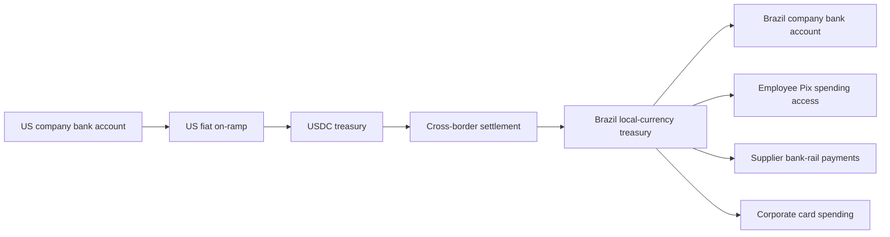
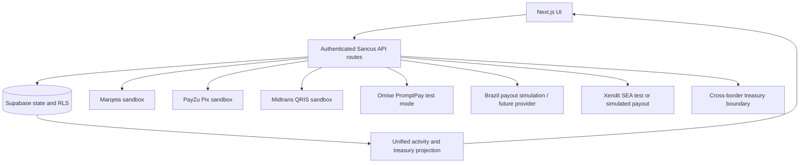

# Sancus payment rails architecture

Generated by `/office-hours` on 2026-11-18
Branch: `main`
Repo: `vysha-exe/Sancus`
Status: **APPROVED**
Mode: Builder

## Problem Statement

US companies need to fund and operate global teams without stitching together separate treasury, cross-border, card, QR, and local-bank products. For the hackathon, Sancus must demonstrate that a Brazilian company can receive global treasury funds and then use familiar local rails—especially Pix—and corporate cards with company controls.

## What Makes This Cool

Sancus is **Ramp, but global, with a programmable treasury underneath**.

A company can move money across borders, hold and route treasury funds, and give local teams familiar ways to receive and spend money. Stablecoins are settlement infrastructure, not the product the customer has to understand.

The motivating flow is a US company funding a Brazilian company:



The target path is:

1. A US company sends dollars from its bank.
2. Dollars are converted to USDC and moved through the Sancus treasury.
3. The receiving Brazilian company gets a usable Brazilian balance and can receive BRL in its own bank account through the teammate-owned settlement flow.
4. The Brazilian company can give employees controlled Pix access for expenses such as a team dinner.
5. The company can also use local bank rails for larger supplier or company-to-company payments.

The “whoa” moment is not any one provider call. It is watching global treasury money become locally useful: one balance can fund a Marqeta card, receive a customer Pix payment, and let a Brazilian employee pay a team-dinner Pix QR under a company limit.

## Constraints

- This is a hackathon: optimize for a reliable stage path, not production completeness.
- Payment rails are this workstream; cross-border US bank → USDC → Brazil settlement is teammate-owned.
- Use real provider sandboxes where they are usable.
- Every fallback must be deterministic and visibly labeled **Simulated**.
- Pix must be part of both the inbound and outbound story.
- Do not block the demo on Xendit or an unavailable Brazilian bank-payout sandbox.

## Premises

- Stablecoins are settlement infrastructure, not the user-facing product.
- “Issue Pix access” means granting controlled outbound spending permission; it does not mean issuing an employee a QR.
- Inbound collection QRs belong on Receive; employee card and Pix controls belong on Team/Spending.
- One canonical implementation should exist for each demo capability.
- Pix is the default stage rail; QRIS, PromptPay, and Xendit demonstrate extensibility.

## Approaches Considered

### Approach A: Pix-first connected loop

Issue a Marqeta card, receive an inbound Pix QR payment, issue controlled employee Pix access, and make an outbound merchant Pix payment. Keep other rails available but off the critical stage path.

### Approach B: Multi-country rail showcase

Demonstrate Pix, QRIS, PromptPay, Xendit, cards, and cross-border settlement equally. This shows breadth but creates too many credentials, simulators, and failure points for a short hackathon demo.

### Approach C: Treasury-only prototype

Show cross-border movement and a final balance without completing local spend rails. This is simpler but misses the product’s strongest differentiation: making treasury funds operational for local teams.

## Recommended Approach

Use **Approach A**. It tells one coherent Brazil story while proving the architecture can add other countries. Marqeta must return a real sandbox card for the primary path. PayZu Pix is both inbound and outbound. Brazilian bank payout is explicitly simulated/provider-TBD, and Xendit remains a separate SEA capability.

## Hackathon boundary

There are two parallel workstreams.

### Cross-border treasury — teammate-owned

- US bank funding and fiat on-ramp
- USDC treasury movement
- US-to-Brazil settlement
- Conversion or representation of value in the Brazilian treasury
- Delivery of BRL into the receiving company's Brazilian balance or own bank account

The payment-rail work should consume a simple regional balance/status interface from this workstream. It should not duplicate the cross-border orchestration.

### Payment rails — current scope

- Issue corporate cards through Marqeta sandbox
- Create inbound customer QR collections, especially Pix
- Give employees outbound Pix spending access with limits and controls
- Pay Brazilian merchants through Pix
- Support larger outbound supplier/company payments through a future Brazilian bank/payout rail
- Show every real or simulated transaction in one activity feed and treasury view

For the hackathon, a provider sandbox response is “real.” When a usable sandbox is unavailable, the fallback must be deterministic and visibly labeled **Simulated**.

Fallbacks must return the same DTO and status lifecycle as their sandbox adapter and persist `simulated: true`, so the UI and activity feed do not need a separate fake-only path.

## Primary demo story

The main demo should be a short connected loop:

1. **Issue a card:** assign a Marqeta sandbox card to an employee and show the provider-issued last four digits.
2. **Receive with Pix:** create a Pix collection QR for a Brazilian customer.
3. **Settle inbound:** PayZu sandbox marks the payment settled; activity and the appropriate treasury balance update.
4. **Issue Pix access:** give an employee a monthly BRL limit. This is spending access, not a QR issued to the employee.
5. **Spend with Pix:** resolve a merchant's Pix copy-and-paste code/QR and make an outbound employee payment.
6. **Show controls:** update used allowance and activity; pause, resume, limit, and revoke the Pix access.
7. **Optional large payout:** show the planned Brazilian bank-rail payout with a deterministic simulation until a suitable provider is selected. Xendit remains a separate Southeast Asia demo capability, not the Brazilian payout provider.

QRIS and PromptPay can remain available as additional inbound collection rails, but they are not required in the stage path. Pix is the default because it demonstrates both money-in and money-out in the same country.

## Rail model

| Capability | Direction | Primary provider | Product object | Hackathon behavior |
| --- | --- | --- | --- | --- |
| Corporate card | Outbound spend | Marqeta sandbox | Issued card | Require a real sandbox card and last four for the primary demo; label the existing fallback as simulated |
| Pix collection | Inbound | PayZu sandbox | Collection QR | Real sandbox QR/status when configured |
| Pix employee spend | Outbound | PayZu sandbox | Spending method + payment | Resolve merchant QR, enforce employee limit, pay |
| QRIS collection | Inbound | Midtrans sandbox | Collection QR | Real QR; paid through Midtrans simulator |
| PromptPay collection | Inbound | Omise test mode | Collection QR | Real test QR/status when configured |
| Brazil bank payout | Outbound | Provider TBD | Payout | Deterministic simulation for the hackathon; do not present Xendit as a Brazil rail |
| SEA bank/e-wallet payout | Outbound | Xendit test mode | Payout | Existing secondary capability; real test payout when possible and deterministic simulation otherwise |
| Cross-border treasury | Funding/settlement | Teammate-owned | Treasury transfer | Integrated through a balance/status boundary |

## Application architecture



Each rail follows the same small lifecycle:

1. Validate the authenticated request and company/employee policy.
2. Send an idempotent request to the provider adapter.
3. Persist the provider identifier, sanitized response, status, and simulation flag.
4. Refresh status through a webhook or explicit sandbox refresh/poll.
5. Project the terminal result into activity and treasury balance views.

We do not need a generic workflow engine for the hackathon. Shared DTO naming and status mapping are enough.

## UI ownership

### Team / employee

- **Issue card** creates a Marqeta card for the selected employee.
- **Issue Pix access** creates an employee spending method with a monthly BRL limit.
- Do not call this action “Issue QR.” Employees receive permission to pay merchant Pix QRs; Sancus does not issue them a receiving QR.
- Card and Pix controls should show active/paused/revoked state and limits.

### Receive

- The real local collection card is the main inbound QR experience.
- Pix is selected by default, with QRIS and PromptPay available as alternatives.
- Show provider-generated QR, amount, provider/test label, and settlement status.
- On settlement, refresh the activity feed and regional treasury balance.

### Spending

- Show provider-issued cards, not hard-coded cards presented as live data.
- Show employee Pix access, allowance used, and pause/resume/limit/revoke controls.
- Resolve and pay a merchant Pix QR/copy-and-paste payload.
- Keep Xendit as a secondary SEA payout capability, visibly real or simulated. Do not label it as a Brazilian bank payout.

### Activity and treasury

- Card issuance is an administrative event; card purchases become money-out events when transaction ingestion is added.
- Inbound Pix/QR settlement is money in.
- Outbound Pix and bank payouts are money out.
- Provider name, sandbox/simulated state, recipient/payer, amount, rail, and terminal status should be visible.
- The cross-border workstream owns delivery into the Brazilian company's usable balance or own bank account. Payment rails consume that balance for later employee Pix and supplier/company payments.

## Current implementation status

| Area | Current state | UI integration | Remaining work |
| --- | --- | --- | --- |
| Marqeta card issuance | Adapter, authenticated API, persistence migration, idempotency, card-product discovery, velocity control, and a simulated fallback are implemented locally | Issue-card action and issued-card loading are wired | Apply migration; configure sandbox credentials/product; require a real sandbox result for the stage path; visibly label any fallback; replace remaining hard-coded cards; add provider transaction ingestion later |
| Inbound local QR | QRIS, PromptPay, and Pix provider adapters and collection APIs exist | Both `CollectionDemo` and `LocalCollectCard` are mounted on Receive | Keep the idempotent `/api/sancus/collections` path already consumed by live activity; remove the duplicate rail-bot UI; default to Pix; connect settlement to the agreed regional balance projection |
| Inbound Pix | PayZu collection creation and status behavior exist | Available through local collections | Verify with configured sandbox; make the settled result visibly update the demo balance/activity |
| Employee Pix access | Spending-method create/update APIs and limit tracking exist | Issuance and management UI exist | Rename “issue QR” to “issue Pix access”; verify pause/resume/revoke/limit end to end |
| Outbound Pix | QR resolution and payment APIs exist | `PixSpendDemo` is mounted on Spending | Verify sandbox payment end to end; ensure balance and allowance update together; provide a deterministic simulated fallback only if the sandbox blocks the demo |
| Xendit outbound | Indonesia/Philippines test payout adapter/API plus simulated fallback exist in the working tree | Payout demo is wired | Verify Development API key and Money-out permission; label fallback clearly; present it as SEA capability, not Brazilian bank payout |
| Brazil bank payout | No suitable provider integration is established | No truthful live provider UI yet | Use a deterministic, visibly simulated flow for the hackathon or leave it outside the stage path; choose a provider after the hackathon |
| Activity | Already maps `/api/sancus/collections`, Pix payments, and Xendit payouts | Live activity hook exists | Remove the duplicate collection source and trigger refresh after terminal events |
| Treasury | Treasury UI/data model exists | Used across balance views | Define the narrow integration contract with the teammate-owned cross-border balance |

## Consolidation decision

There are currently two inbound collection paths:

- `/api/sancus/collections` with `CollectionDemo`
- `/api/sancus/rails/collections` with `LocalCollectCard`

For the hackathon, use `/api/sancus/collections` and `CollectionDemo` as the canonical experience. That path already has idempotency and provider refresh behavior and is consumed by `use-live-activity`. It also avoids coupling payment rails to the mock-token mint owned by the broader treasury story. Remove `LocalCollectCard` from the primary Receive page and either delete the duplicate after verification or leave it unused until after judging.

Also replace the static “Get paid by someone else” QR placeholder with the real collection card rather than showing both.

## Minimal integration contract with cross-border work

The payment-rail code needs only this conceptual interface:

```ts
type RegionalTreasury = {
  companyId: string
  country: "BR"
  currency: "BRL"
  availableMinor: string
  reservedMinor: string
  settlementState: "PENDING" | "AVAILABLE" | "FAILED"
  updatedAt: string
}
```

Outbound Pix or Brazilian bank payments reserve and then debit the regional balance. Inbound local collections credit it when settled. The teammate's cross-border flow credits it after the USDC-to-Brazil settlement completes or reports delivery to the company's own bank account. For the demo, the shared balance can be a database-backed projection even if final fiat reconciliation is simulated.

## Open Questions

- What exact database/API event will the cross-border workstream emit when Brazilian funds become usable?
- Will the stage environment have usable PayZu credentials for both inbound and outbound Pix, or should the fallback be prepared in advance?
- Which provider should eventually handle Brazilian business bank payouts? This does not need to be decided for the hackathon.

## Success Criteria

- A judge can see a real Marqeta sandbox card assigned to an employee.
- A customer Pix QR can settle and appear in activity.
- An employee can receive limited Pix access and complete a merchant payment.
- The UI clearly distinguishes sandbox-backed and simulated events.
- The payment-rail demo consumes the teammate-owned Brazilian balance without duplicating cross-border orchestration.
- The critical demo path works from a seeded/resettable environment without manual database edits.

## Distribution Plan

The existing Next.js deployment pipeline covers the web demo. Supabase hosts persisted demo state and migrations. Provider credentials are deployment secrets. No separate package, binary, or production provider onboarding is required for the hackathon.

## Next Steps

- [ ] Apply the card and collection database migrations in the demo environment.
- [ ] Configure and verify one Marqeta sandbox card issuance.
- [ ] Configure and verify PayZu inbound Pix QR settlement.
- [ ] Configure and verify employee outbound Pix QR payment.
- [ ] Rename QR issuance to Pix spending access throughout the UI.
- [ ] Keep only one inbound collection component on Receive.
- [ ] Replace live-looking hard-coded cards/transactions or label them as sample data.
- [ ] Refresh activity and balance after inbound/outbound Pix terminal states.
- [ ] Keep the Brazil bank payout visibly simulated until a suitable provider is selected.
- [ ] Optionally verify Xendit as a separate SEA payout; retain its deterministic simulated fallback.
- [ ] Agree on the regional treasury balance contract with the cross-border teammate.
- [ ] Treat that balance event as the only blocking dependency for the connected-loop balance update; use an agreed seeded projection if the cross-border event is not ready by demo freeze.
- [ ] Prepare seeded demo users, known amounts, and a reset procedure.

## Explicit non-goals for the hackathon

- Production card PAN display or PCI program design
- Production reconciliation across every provider
- A generic multi-provider workflow engine
- Full double-entry accounting for every sandbox event
- Production fraud, dispute, chargeback, or KYC operations
- Making every country rail part of the live stage demo
- Blocking the demo on Xendit sandbox approval

## What I noticed about how you think

- You anchored the product with “Ramp but global + treasury,” which is more useful than starting from a list of providers.
- You insisted that Pix belong to both money-in and money-out; that turns it from a checkbox integration into a coherent local operating story.
- You drew a clean ownership line around your teammate's cross-border work instead of rebuilding it inside the payment-rail scope.
- You were willing to mock an unavailable outbound rail, but only after keeping the real customer outcome and labeling the simulation honestly.
