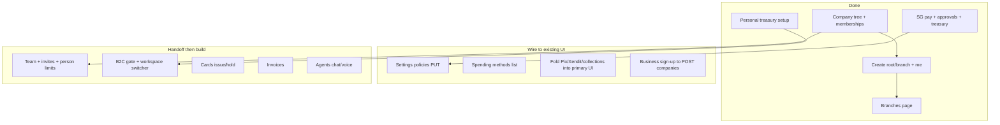

# Business Accounts, Branches, B2C & wiring plan

**Audited at:** `3e8d6ad`  
**Sources:** this doc, [`BUILD.md`](../BUILD.md) (repo root), [`BACKEND-CHECKLIST.md`](BACKEND-CHECKLIST.md), live `app/app/api/sancus/**` vs `app/app/(sancus)/**`.

**Goal:** Finish business-account tenancy + Team/B2C, and for every backend feature that isn’t in the primary UI yet either **wire it into existing screens** or **hand it to Claude wireframes** (then implement). Pull still-relevant BUILD.md requirements into the same plan (ignore Privy / Prisma / Solidity-factory as superseded by Supabase + Circle).

## Decisions locked

- **Pipeline:** plan → Claude handoff → wireframes → implement / wire.
- **B2C:** one personal wallet; strip Team / Branches / company chrome.
- **B2B:** company **tree**; one wallet per node; access inherits down; node-local membership overrides; children never manage parents.
- **Roles:** `OWNER | ADMIN | FINANCE | EMPLOYEE | VIEWER` (Viewer for demo accountant). BUILD’s 4-role model is extended with VIEWER.
- **EMPLOYEE pay (overrides BUILD 4.4):** Employee **can pay within limits** (matches [`companies.ts`](../app/lib/sancus/companies.ts) + Team demo). Card/QR is additional spend, not the only path.
- **Depth:** max 6. **One wallet per node** (no extra-wallet API).
- **Stack override (from BUILD “Decision update”):** Circle developer-controlled wallets + Supabase — not Privy/Prisma/factory-deploy on create.

---

## Status: business accounts core

### Done — do not rebuild

| Area | Where |
|---|---|
| Company tree, memberships, VIEWER, SQL inheritance, `wallets.company_id` | [`20261118100000_sancus_companies_branches.sql`](../app/supabase/migrations/20261118100000_sancus_companies_branches.sql) |
| Capabilities + tree helpers | [`lib/sancus/companies.ts`](../app/lib/sancus/companies.ts) |
| `POST /companies`, `POST …/branches`, `GET …/me`, `POST/GET /treasury/setup` | `app/app/api/sancus/companies/**`, `treasury/setup` |
| Branches UI | [`branches/page.tsx`](../app/app/(sancus)/branches/page.tsx) |
| Local rails mint into branch wallet by country | [`rail-collections.ts`](../app/lib/sancus/rail-collections.ts) |

### Still open (business accounts)

| Gap | Notes |
|---|---|
| Invite tokens + member APIs | P2: invite / role change / accept |
| `sancus_notifications` | Invites, role changes, branch created |
| `company_id` on payouts + company policies | Workspace header/cookie; role checks on pay/approve |
| Team UI live | Still `demo-data`; person + methods screens exist as mocks |
| Per-member limits | BUILD + wireframes; not only company `sancus_policies` |
| B2C onboarding + nav gating | Hide Team/Branches for personal |
| Business sign-up → live APIs | Mock funnel exists; must call company create + invites |
| Circle wallet types | BUILD/checklist: treasury / operator / agent (+ passkey approver) — at least on root |
| Recipients `company_id` + idempotency per company | BUILD Phase 3 |
| Rich seed | Café and/or Lion City + recipients + policies + sample payouts |
| Checklist §10 | Still flat + all ⬜ — stale |

---

## Backend ↔ frontend: wire or handoff

Rule: if an API exists and a screen exists, **wire**. If UX is missing or wrong shape, **handoff** first. If both backend and UX are missing, handoff then build.

| Feature | Backend | Frontend today | Action |
|---|---|---|---|
| Treasury summary + setup | ✅ | Live (Home/Settings/Receive) | **done** |
| SG PayNow payouts + quote | ✅ | Live Pay flow | **done** |
| Approvals queue + decide | ✅ | Live Activity/Approvals + badge | **done** (add self-approve block when roles live) |
| Policies `GET/PUT` | ✅ | Settings rules (threshold + toggles) live; `newRecipients` enforced | **done** |
| Ledger CSV | ✅ | Settings | **done**; journals for collections/cards still backlog |
| x402 earnings | ✅ | Agents tile live | **done** |
| Companies / branches | ✅ | Branches live | **done** |
| Memberships schema | ✅ table | Team live when company exists | **done** |
| Invite / role APIs | ✅ | Invite sheet + role/disable on person page | **done** (email still stubbed) |
| Pix payments + spending-methods | ✅ | Spending lists live methods; freeze/limit wired | **done** |
| Collections / local rails | ✅ (dual stacks) | Receive demo panels | **wire** into primary Receive (not only bolted demos) |
| Xendit payouts | ✅ | Spending demo panel | **wire** into Pay or Spending primary flow |
| Demo-login | ✅ | Shell / proxy | **done** |
| B2C vs B2B chrome | Partial (personal wallets) | Always show Team/Branches | **handoff** + implement gate/switcher |
| Workspace switcher | ⬜ | Demo chip | **handoff** + implement |
| Cards / Marqeta | 🟡 | Spending: issue/list/freeze + simulate hold→settle | **done** for demo path; JIT/webhook still open |
| Invoices | 🟡 | Upload → extract → confirm → Pay | **done** slice; apply invoices migration |
| Agents chat / budget / voice | 🟡 | `AgentConsole` mounted; budget from agent status | **done** for typed path; voice needs keys |
| Multi-corridor Pay (ACH/SEPA/SPEI) | ⬜ / sim | Demo recipients labeled **Simulated** on Pay › Who | **done** labeling; adapters later |
| Recipients address book API | ⬜ | Hardcoded `demo-data` | **build** with `company_id` (BUILD) + wire Pay › Who |

### Cheap wire wins (do early)

1. Settings approval rules → `PUT /api/sancus/policies`
2. Spending → list `GET /spending-methods`; freeze via PATCH where supported
3. Receive → promote collections UI from demo panel to primary “Get paid locally”
4. Activity → ensure Pix / Xendit / collections already in `use-live-activity` stay first-class (not empty-state fallback to fake rows when live data exists)

### Handoff package (Claude) — must include

Path: [`docs/handoffs/business-accounts-wireframes.md`](handoffs/business-accounts-wireframes.md) (create).

- Account type gate (Personal vs Business) + B2C stripped shell
- Workspace / branch switcher
- Team list (inherited role), invite sheet, person detail, change role, per-person limits
- Assign card / local QR against a member (even if backend starts simulated)
- Settings policies as live controls (wireframe can show loading/error)
- Receive local-rails as primary, not a side demo
- Invoices upload → confirm → pay (BUILD)
- Agents chat / voice (BUILD/checklist §14) as stretch screens
- Cards hold/settle story (BUILD DoD)

Brand: [`docs/brand/guidelines.md`](brand/guidelines.md), [`patterns.md`](brand/patterns.md). Extend existing `docs/wireframes/*.dc.html` where possible.

---

## From BUILD.md — add to this slice

Still relevant (map to Supabase + Circle, not Privy/Prisma/Solidity factory):

| BUILD item | Plan action |
|---|---|
| Membership role authZ on money APIs | Widen beyond pay/approve → policies, recipients, cards, ledger |
| Per-user daily / per-payment limits | Schema + Team person UI (`/settings/team` → our `/team/[id]`) |
| Onboarding: company + country + invites → wallets | Wire existing sign-up steps to `POST /companies` + invites |
| Recipients with `companyId` | New table/API; Pay › Who |
| Idempotency unique per company | When payouts gain `company_id` |
| Cards on membership | Handoff + API when ready; Team methods screen in scope |
| Invoices upload → prefill pay | Handoff then §11 backend |
| Seed: company + roles + multi-rail recipients | Expand seed (Café and/or Lion City) + sample payouts/policies |
| Passkey admin approvals | Checklist P1; link to OWNER/ADMIN after memberships live |
| Treasury / operator / agent wallet types | Provision on root (checklist §2); branch keeps one primary wallet |
| Golden rules | SIMULATED labels, integer minor units, idempotent POSTs on company paths |

**Explicitly ignore from BUILD for this work:** Privy, Prisma monorepo, `SancusTreasuryFactory` on every create, on-chain role mapping, Brazil-first as default corridor (SG-first stays).

---

## Permission matrix (current code)

| Role | Pay | Approve | Policies | Invite / roles | Create branch |
|---|---|---|---|---|---|
| OWNER | yes | yes | yes | yes | yes |
| ADMIN | in limits | yes | yes | yes (not OWNER) | yes |
| FINANCE | in limits | yes | no | no | no |
| EMPLOYEE | in limits | no | no | no | no |
| VIEWER | no | no | no | no | read-only |

---

## Implementation order

1. **Handoff doc** (business + backend-not-frontend screens above) so wireframes can run in parallel  
2. **Wire cheap wins:** Settings policies; Spending methods; Receive/Pay fold-in for Pix/Xendit/collections  
3. **Invite schema + P2 member APIs** + notifications stub  
4. **Wire Team** (list + person + methods) to memberships; per-member limits  
5. **Company tenancy:** `company_id` on payouts + company policies; workspace context; role enforcement + approver ≠ requester  
6. **B2C/B2B onboarding** + shell nav gating + business sign-up → `POST /companies`  
7. **Recipients API** (company-scoped) + Pay › Who live list  
8. **Root wallet types** (treasury/operator/agent) as capacity allows  
9. **Seed + checklist §10 refresh** (+ frontend wiring table for policies/rails/branches/Team)  
10. **Cards / invoices / agents voice** — after handoff; don’t block Team/tenancy

## Implementation todos

- [x] Company tree, memberships, VIEWER, wallet `company_id`, P1 APIs, Branches UI, personal treasury  
- [x] Claude handoff → [`handoffs/business-accounts-wireframes.md`](handoffs/business-accounts-wireframes.md)  
- [x] Wire Settings → policies (threshold); Spending → spending-methods; Receive local rails primary  
- [x] Invite APIs + notifications table + accept RPC (migration `20261118200000_…`)  
- [x] Wire Team list + invite sheet (person limits UI still thin)  
- [x] B2C nav gate (hide Team/Branches when no company) + sign-up account-type step  
- [x] Checklist §10 / frontend wiring table refreshed  
- [ ] Company-scoped payouts/policies wired into money routes + workspace switcher UI  
- [ ] Business sign-up calling `POST /companies` + invite persistence  
- [ ] Recipients `company_id` + Pay › Who  
- [ ] Seed demo company + roles  
- [ ] Cards / invoices / agent voice (post-handoff)

## Out of scope (first pass)

- On-chain treasury factory / roles  
- Real invite email provider  
- Multi-wallet-per-node API  
- Full `company_id` migration of every local-rail/Xendit row (payouts/policies first; don’t break `resolveDestination`)
