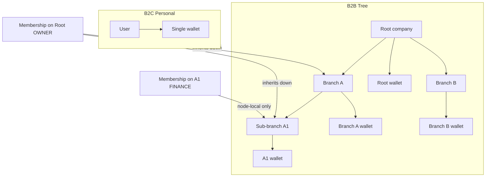

# Business Accounts, Branches & B2C

Research / implementation plan for B2B company trees and B2C personal wallets.

**Overview:** Add B2B company trees (branch nodes with independent wallets + ancestor permission inheritance) and a lean B2C personal wallet path, then ship schema, APIs, Team/onboarding wiring, and a Claude wireframe handoff.

## Decisions locked

- **Pipeline:** plan → Claude handoff → wireframes → implement.
- **B2C:** one personal wallet; strip Team / branches / company chrome from that mode.
- **B2B:** company is a **tree**; each node owns its own wallet; access = membership on that node **or any ancestor**; node-local memberships can override/add people; children never manage parents.
- **Roles:** `OWNER | ADMIN | FINANCE | EMPLOYEE | VIEWER` (Viewer kept for demo accountant).

## What exists today (and must change)

- No `sancus_companies` / memberships. Tenancy is `user_id` only on [`wallets`](../app/supabase/migrations/20251210161755_create_wallets_table.sql), payouts, policies, ledger.
- Team + business sign-up are mock ([`demo-data.ts`](../app/lib/sancus/demo-data.ts), [`sign-up-state.tsx`](../app/lib/sancus/sign-up-state.tsx)).
- Checklist §10 is flat “one company per user” — we expand it for tree + B2C + Viewer.

## DB changes (required)

New migration under [`app/supabase/migrations/`](../app/supabase/migrations/):

### 1. `sancus_companies` (tree nodes)

- `id`, `parent_id` (null = root), `root_id` (denormalized, = self for roots)
- `name`, `country`, `base_currency`
- `created_by`, `created_at`, `updated_at`
- Index `(root_id)`, `(parent_id)`; check `parent_id` and child share same `root_id`

### 2. `sancus_memberships`

- `company_id` (node), `user_id`, `role` enum including **VIEWER**
- `status`: `ACTIVE | INVITED | DISABLED`
- Unique `(company_id, user_id)`
- Invite metadata: `invited_by`, `invited_email`, `invite_token`, `expires_at`, `accepted_at`

### 3. Wallets

- Add nullable `company_id → sancus_companies`
- **B2C:** `company_id IS NULL`, still `user_id` = owner
- **B2B:** each node gets one primary treasury wallet; `user_id` remains Circle operator (creator/service), access enforced via membership tree — not raw `user_id` RLS alone
- Add helper SQL `sancus_user_company_ids(uid)` / `sancus_can_access_company(uid, company_id)` (ancestor walk) and rewrite wallet RLS to allow personal owner **or** membership access

### 4. Tenancy follow-on (same or immediate next migration)

- Add nullable `company_id` to `sancus_policies`, `sancus_payouts`, journals/ledger
- Policies: one row per **company node** (inherit from nearest ancestor with a policy if child has none — app-layer resolve)
- Existing user-scoped demo rows: backfill optional; new flows always set `company_id` in B2B

### 5. Lightweight notifications (for invites / role / branch)

- `sancus_notifications` (`user_id`, `type`, `payload jsonb`, `read_at`, `created_at`) — in-app first; email can stub “sent” for demo

No separate `branches` table — a branch **is** a company row with `parent_id`.

## Permission model

Effective membership at node N for user U:

1. If ACTIVE membership on N → use that role (node-local wins).
2. Else walk ancestors toward root; first ACTIVE membership wins (inheritance).
3. Else no access.

Capability matrix (enforce in [`lib/sancus/policy.ts`](../app/lib/sancus/policy.ts) + new `lib/sancus/permissions.ts`):

| Role | Pay | Approve | Edit policies | Invite / change roles | Create child branch | Manage descendant nodes |
|---|---|---|---|---|---|---|
| OWNER | yes unlimited* | yes | yes | yes | yes | yes |
| ADMIN | yes in limits | yes | yes | yes (not OWNER) | yes | yes |
| FINANCE | yes in limits | yes (within approve cap) | no | no | no | no |
| EMPLOYEE | yes in limits | no | no | no | no | no |
| VIEWER | no | no | no | no | no | read-only |

\*Still respect optional org kill-switch later; demo can match current UI “no limit”.

Rule: **descendant never gains rights on ancestor**. Creating a child branch requires ADMIN+ on parent. Assigning someone OWNER on a child does not grant rights on parent.

## APIs ([`app/app/api/sancus/`](../app/app/api/sancus/))

### P1

- `POST /api/sancus/companies` — create root (+ treasury wallet); body: name, country, currency
- `POST /api/sancus/companies/:id/branches` — create child node + its wallet
- `GET /api/sancus/companies/me` — list memberships + tree summary for active workspace
- `GET /api/sancus/companies/:id` — node detail + children + wallet + effective role
- `POST /api/sancus/accounts/personal` — B2C: ensure personal wallet, no company

### P2

- `POST /api/sancus/companies/:id/members` — invite (email + role)
- `PATCH /api/sancus/companies/members/:id` — role / disable
- `POST /api/sancus/invites/:token/accept` — attach user to membership

Active workspace: cookie or header `X-Sancus-Company-Id` (null = personal). Treasury / payouts / policies resolve against that node’s wallet + inherited policy.

## User flows

**B2C onboarding:** email → code → name/country → currency → done → single wallet. No company/team steps. App shell hides Team, branch switcher, company settings.

**B2B onboarding:** email → code → company → currency → optional invites → create root company + wallet → home. Later: Settings / Team → add branches, invite, change roles.

**Branch switcher:** Owner/Admin of root picks node; balances/pay/approvals scoped to that node’s wallet (independent balances).

**Notifications (minimal):** invite received, role changed, approval needed (reuse existing badge), branch created — write `sancus_notifications` + toast.

## UI work

- Fork sign-up: account-type choice (Personal vs Business) early; Personal skips company/team ([`sign-up-steps.tsx`](../app/components/sancus-ui/sign-up-steps.tsx)).
- Team page: replace demo-only table with API data; show branch context; keep Viewer.
- Settings: real workspace name; “Switch workspace” → personal vs companies/branches.
- Hide Team nav for personal accounts ([`app-shell.tsx`](../app/components/sancus-ui/app-shell.tsx)).

## Claude wireframe handoff (deliverable before/with build)

Create [`docs/handoffs/business-accounts-wireframes.md`](handoffs/business-accounts-wireframes.md) pasteable to Claude, covering:

- Account-type gate + B2C vs B2B sign-up maps
- Branch tree manager (create child, see wallet per node)
- Team list filtered by node + “inherited from parent” badges
- Invite / change-role sheets; Viewer read-only states
- Workspace / branch switcher in shell
- Notification moments
- Permission matrix + empty/error states
- Brand constraints from [`docs/brand/patterns.md`](brand/patterns.md) / guidelines
- Existing wireframes to extend: `SignUp*.dc.html`, `Team.dc.html`, `Employee.dc.html`, `Settings.dc.html`

Generate HTML wireframes in Claude from that handoff; align implementation to those screens.

## Implementation order

1. Handoff doc (so wireframes can proceed in parallel)
2. Migrations + SQL access helpers
3. `lib/sancus/companies.ts` + `permissions.ts` + tests
4. P1 company/personal/branch APIs
5. Hook treasury/payouts/policies/approvals to company context + role checks (closes checklist “approver ≠ requester”)
6. Onboarding + shell account-type gating
7. Team + branch UI wiring
8. P2 invites / role PATCH + notification rows
9. Demo seed: root + 1–2 branches, Maya Owner, Rafael Finance, Ana Employee, João Viewer
10. Update [`docs/BACKEND-CHECKLIST.md`](BACKEND-CHECKLIST.md) §10

## Implementation todos

- [ ] Write Claude wireframe handoff (flows, screens, perms matrix, branch tree UX) under docs/
- [ ] Add companies tree, memberships (+VIEWER), invitations; attach wallets.company_id; helpers for ancestor access
- [ ] Implement lib/sancus/companies.ts + permissions (effective role, canManage, canApprove, canPay)
- [ ] P1 company onboarding APIs + P2 invites/role/branch create endpoints
- [ ] Scope policies/payouts/approvals/treasury by active company context; enforce roles
- [ ] Split onboarding: personal (single wallet) vs business (company+team); hide Team/branches for B2C
- [ ] Wire Team screen + branch switcher/tree to live APIs; keep Viewer for demo
- [ ] Seed demo root company, 1–2 branches, Owner/Finance/Employee/Viewer memberships + wallets
- [ ] Update BACKEND-CHECKLIST §10 for tree, VIEWER, B2C, and new endpoints

## Out of scope for this slice

- On-chain `SancusTreasury.sol` roles
- Real invite email provider (stub + in-app notification)
- Moving every legacy Circle sample route off `user_id` (only Sancus product paths + wallet RLS)
